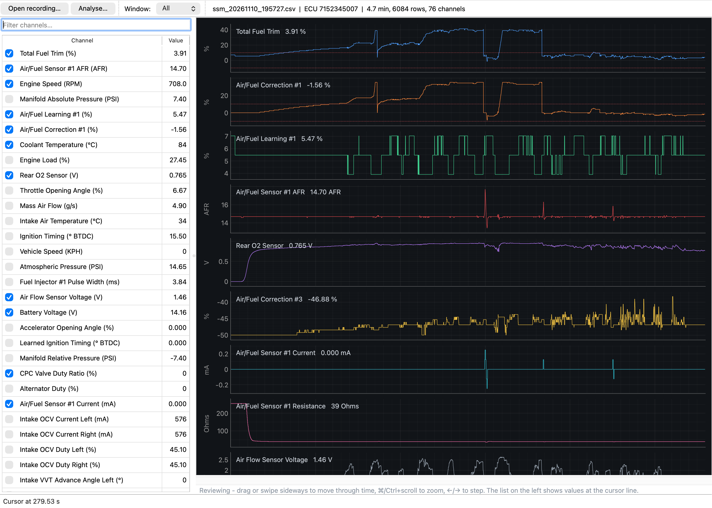

# ssm-logger

A live data logger, fault-code reader and fuel-trim analyser for Subaru ECUs that speak
SSM over CAN, using a **Tactrix OpenPort 2.0** cable on macOS (Linux should work but is untested). Written for and tested on a
2012 Forester (FB25, ECU `7152345007`).



*Reviewing a recording of a P0171 (system too lean) fault on a 2012 Forester. Fuel trim climbs
to about +35% and only drops back after fuel cuts. The front A/F sensor reads flat 14.7 AFR
while the rear O2 sensor reads rich. Replacing the front A/F sensor fixed it.*

## Features

- **Live logging** of every SSM parameter the ECU reports as supported, charted in real
  time and recorded to `logs/ssm_YYYYMMDD_HHMMSS.csv`. Press **M** to drop numbered markers
  (handy while wiggling connectors), **Space** to pause and scroll back.
- **Gauges** (the Gauges button, or **G**): a glanceable alternative to the charts. Each channel
  gets the gauge that suits it - a needle for revs, speed, coolant and boost, a centre bar for fuel
  trims and AFR, a bar for throttle, voltage and airflow, a big number with a one-minute trend,
  or a lamp for switches - with coloured zones and the lowest/highest values marked. Pick which
  channels to show and change any gauge's style; recordings can be scrubbed or played back.
  Size makes every gauge Small, Medium or Large, or **Per gauge** lets you size each one (S, M, L
  or Wide) so the important ones stand out; smaller gauges fill in the gaps beside big ones.
  Save a set of gauges (with their styles and sizes) as a named layout (e.g. "Warm-up",
  "Fuel trims") to switch between, or reset to the default.
- **Fault codes**: stored, pending and permanent OBD-II codes, freeze frame, readiness
  monitors, and clearing (standard OBD-II modes 01/02/03/04/07/0A).
- **On-board test results** (OBD mode 06): the measured value and pass/fail limits of every
  self-test the ECU has run - catalyst, O2/A/F sensors and heaters, misfire, EVAP. Values within
  10% of a limit are flagged: an early warning before a test fails and sets a code.
- **Auto-capture** for intermittent faults: when a trigger fires - a rule such as total fuel trim
  above +25% for 2 s, a new stored or pending code, or **C** for "capture now" - the data from
  30 s before to 30 s after is saved as its own recording (`logs/…_capture.csv`), whether or not
  you're recording. Triggers and the window are configurable (Tools ▸ Auto-capture settings).
- **Alerts** while logging: a red banner (and a beep) when a value crosses a limit - by default
  coolant above 105 °C or charging voltage below 12.5 V. Rules are editable (Tools ▸ Alert settings).
- **Readiness tracker**: which readiness monitors are still incomplete, with general advice on the
  driving that completes each, rechecked every 30 s if you like so you can watch them finish.
- **Vehicle information** (OBD mode 09): VIN, ECU name, calibration ID and CVN, and how often each
  monitor actually gets to run.
- **Guided tests** (Tools ▸ Guided tests): step-by-step checks that judge the data from Start to
  Finish - warm-up and thermostat, front A/F sensor response, vacuum leak vs sensor (idle vs
  2500 rpm), battery and charging, and a boost pull for turbo engines. They also run on part of
  a saved recording.
- **Compare** two recordings (Tools ▸ Compare): the second is drawn dashed on the same charts,
  with a time shift to line up the same event - e.g. before and after a repair.
- **Report** (Tools ▸ Report): one self-contained HTML page with codes, freeze frame, monitors,
  test results, vehicle info, the analysis and charts - to share with a mechanic or print to PDF.
  The VIN is left out unless you include it.
- **Analysis**: rule-based checks aimed at fuel-trim and sensor faults - trims against
  coolant temperature and airflow, front A/F vs rear O2 sensor, A/F sensor response to fuel
  cuts, MAF glitches, charging voltage, misfire counts, and on turbo engines boost, fuelling
  under boost and knock. Each finding links to the time ranges it is based on.
- **Engine profiles** (Tools ▸ Engine profile): what counts as normal differs between engines,
  so the analysis and guided tests use a profile - naturally aspirated 2.5 L (FB25, EJ25),
  naturally aspirated 2.0 L (FB20, FA20, EJ20) or turbo (EJ20/EJ25 turbo, FA20DIT, FA24DIT).
  *Automatic* picks turbo when the ECU reports a wastegate duty or the log shows boost, and NA
  2.5 L otherwise; choose 2.0 L by hand. The numbers live in `profiles.py`.
- **Log review** of saved recordings, including CSVs from the OpenPort's own SD-card logging.

## Browser version

**[kieranwood.github.io/ssm-logger](https://kieranwood.github.io/ssm-logger/)** - nothing to install.

- **View and analyse recordings** in any modern browser: drop in a CSV from this logger or from
  the OpenPort's SD card. [Open it with a sample recording](https://kieranwood.github.io/ssm-logger/?sample)
  (the failing front A/F sensor log in the screenshot above).
- **Log live from the car** in Chrome or Edge (version 137 or newer) on a desktop computer:
  plug in the OpenPort, turn the ignition on and press **Connect to car**. Charts, markers (M),
  pause (Space), recording to a CSV download in the desktop app's format, auto-capture, alerts,
  the readiness tracker, guided tests, reports, analysis, fault codes (read and clear), test
  results and vehicle information all work as in the desktop app. (Comparing recordings works on
  saved recordings in the browser, and during live logging in the desktop app.)
- **[Live demo](https://kieranwood.github.io/ssm-logger/?demo)**: replays the sample through an
  emulated OpenPort and ECU, so you can try live mode without a car, in any browser. (Reading
  fault codes in the demo also needs Chrome or Edge 137+.)

It runs this repo's own `recording.py`, `analyse.py`, `defs.py` and `dtc.py` in the browser with
[Pyodide](https://pyodide.org), and talks to the cable with Web Serial, so files and data never
leave your computer. The first visit downloads about 10 MB (Python and numpy), which the browser
then caches. Live mode also downloads RomRaider's `log_defs.xml` from the same pinned commit as
`fetch_defs.py`.

Live logging in the browser is new and has so far only been tested against the emulated ECU -
if it doesn't connect to your car, the desktop app is the fallback (and please open an issue).

To run it locally, serve the repo root and open `/web/`:

```sh
python3 -m http.server 8000    # then open http://localhost:8000/web/
```

`/web/?url=path/to/log.csv` opens a recording straight away, `?sample` the sample and `?demo`
the live demo.

## Requirements

- Python 3.10+ on macOS or Linux
- Tactrix OpenPort 2.0 (shows up as a USB serial device; no J2534 driver needed)
- RomRaider's logger definitions (`log_defs.xml`) for the parameter list, addresses and
  scaling - downloaded by `fetch_defs.py`, see below

## Setup

```sh
python3 -m venv .venv
.venv/bin/pip install -r requirements.txt
.venv/bin/python fetch_defs.py    # downloads RomRaider's log_defs.xml into definitions/
```

`fetch_defs.py` downloads the file from a fixed [RomRaider](https://github.com/RomRaider/RomRaider)
commit and checks its SHA-256. To use a different copy, set `SSM_LOG_DEFS=/path/to/log_defs.xml`
or pass `--defs` to `logger.py`. An existing RomRaider checkout at
`~/source/RomRaider/definitions/log_defs.xml` is also picked up.

## Usage

```sh
.venv/bin/python logger.py                  # connect to the car (ignition on)
.venv/bin/python logger.py --demo           # simulated data, no car needed
.venv/bin/python logger.py --open FILE.csv  # review a saved log

.venv/bin/python dtc.py                     # read codes, freeze frame, readiness
.venv/bin/python dtc.py --clear             # clear codes (asks first)
.venv/bin/python dtc.py --port /dev/ttyACM0  # any command: name the cable if auto-detect fails

.venv/bin/python analyse.py logs/ssm_....csv   # --engine na25|na20|turbo (default: auto)
.venv/bin/python probe.py [--debug]         # minimal connection test
```

## Platforms

| Platform | Status |
|---|---|
| macOS | Tested with a real car. |
| Linux | Should work, untested on a car. The cable usually appears as `/dev/ttyACM0`. If you get "permission denied", add yourself to the serial group and log in again: `sudo usermod -aG dialout $USER` (`uucp` on Arch). |
| Windows | Not supported for talking to the car: Tactrix's Windows driver normally takes over the cable and expects programs to use its J2534 interface. Demo mode, log review and `analyse.py` work. |

The cable is found by its USB ID (`0403:cc4c`), falling back to `/dev/cu.usbmodem*` (macOS) and
`/dev/ttyACM*` (Linux). `--port` overrides it on `logger.py`, `dtc.py` and `probe.py`.

## Files

| File | Purpose |
|---|---|
| `logger.py` | Qt GUI: live charts, recording, markers, review, fault codes, analysis |
| `sources.py` | ECU data source (SSM over ISO 15765) and a demo simulator |
| `openport.py` | Minimal OpenPort 2.0 driver over its USB serial port |
| `defs.py` | Loads SSM parameter definitions from RomRaider's `log_defs.xml` |
| `fetch_defs.py` | Downloads `log_defs.xml` from RomRaider into `definitions/` |
| `dtc.py` | OBD-II codes, freeze frame, readiness monitors (with hints), on-board test results (mode 06) and vehicle information (mode 09) |
| `capture.py` | Auto-capture triggers and saving the window around them, and alerts (desktop and browser) |
| `guided.py` | Guided tests: steps and the checks run on the data from Start to Finish |
| `report.py` | Builds the shareable HTML report |
| `analyse.py` | Rule-based checks on a recording |
| `gauges.py` | Which gauge suits each channel, its range and zones (shared by both apps) |
| `gauge_view.py` | The desktop gauge view (Qt); the browser's is `web/gauges.js` |
| `profiles.py` | Engine profiles: the engine-specific thresholds, and auto-detection |
| `recording.py` | Loads logger CSVs and OpenPort SD-card CSVs |
| `probe.py` | Proof-of-concept connection test |
| `web/` | Browser version: viewer, live logging over Web Serial (`openport.js`, `live.js`), demo ECU (`fake-ecu.js`), Python glue (`webapp.py`). Deployed to GitHub Pages by `.github/workflows/pages.yml` |
| `sdcard/logcfg.txt` | OpenPort standalone (SD card) logging config for the 2012 Forester |

## Limitations

- **Subaru only** for live logging: it reads SSM memory addresses, which other makes don't
  answer. The fault-code reader uses standard OBD-II and should work on most cars with
  500 kbit/s CAN and the engine ECU at `0x7E0`/`0x7E8`.
- The analysis thresholds are rules of thumb, checked against real logs only on a naturally
  aspirated FB25 (2012 Forester). The 2.0 L and turbo profiles are educated guesses - corrections
  from owners of those engines are welcome. Findings are hints, not a diagnosis.
- Every check assumes a front wideband A/F sensor and a rear narrowband O2 sensor, as on
  Subarus from about 2005 on.
- On the FB25 ECU, *A/F Correction #3* rests around −50 %, not 0 %. Where it rests on turbo
  ECUs isn't known, so that profile reports it without judging it.
- Each SSM read asks for up to 84 addresses, the most the 2012 Forester ECU accepts. Other ECUs
  may accept fewer (`MAX_ADDRESSES_PER_READ` in `sources.py` and `web/live.js`).

## Licence

This project is released under the [MIT License](LICENSE).

The parameter definitions file `log_defs.xml` belongs to the
[RomRaider](https://github.com/RomRaider/RomRaider) project, which is licensed under the GNU
GPL v2 or later. It is not included in this repository; `fetch_defs.py` downloads it from
RomRaider at setup time. Thanks to the RomRaider contributors for their work documenting
Subaru's SSM protocol.

Not affiliated with or endorsed by Subaru, RomRaider or Tactrix. Use at your own risk -
clearing codes or polling the ECU while driving is your responsibility.
